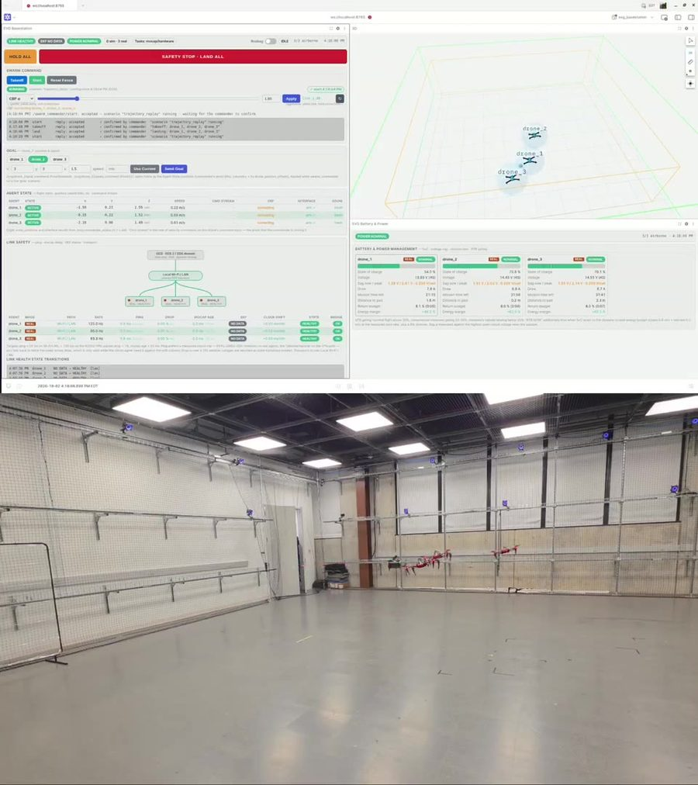
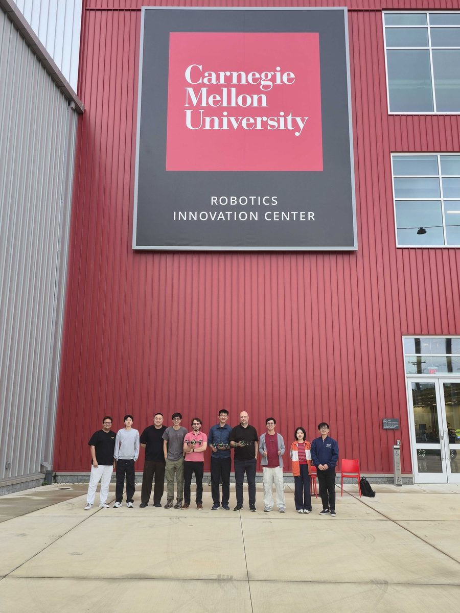

---
# ─────────────────────────────────────────────────────────────────────────────
# Carnegie Mellon University's partner file. Edit the fields below and the text
# under the second "---". See CONTRIBUTING.md for how to preview before publishing.
# ─────────────────────────────────────────────────────────────────────────────
short: CMU
institution: Carnegie Mellon University
lab: AirLab
lead: Prof Sebastian Scherer
role: Research partner
contribution: AirStack flight software, safety filter and flight testing
summary: >-
  CMU's AirLab provides AirStack, the shared flight software that both strategy
  tracks run on, co-develops the safety filter, and flies the drone teams in its
  indoor flight cage.
layers: [safety, flight, drones]
logo: ./CMU/cmu.png
labLogo: ./CMU/airlab.png
logoAlt: Carnegie Mellon University
website: https://theairlab.org
order: 3
updated: 2026-11-02
---

## Our role in Strike vs Guard

The AirLab at Carnegie Mellon University provides the common ground that makes
a head-to-head comparison possible: **AirStack**, the flight software that turns
team plans into flight on real Starling 2 Max drones. Both the learning-based
and the formal strategy tracks run on it.

## What we are working on

- **AirStack.** A shared autonomy stack for the whole programme, from simulation
  to real drones.
- **Safety filter.** With UPenn, a layer that checks every command so that the
  drones never collide, whatever the strategy above it decides.
- **Flight testing.** Multi-drone flights in CMU's indoor flight cage.

## Results so far

Three Starling 2 Max drones have flown in CMU's flight cage with no pilot: changing
formation while keeping their spacing, flying to separate goals with crossing
paths resolved on their own, and continuing their task while a hand-flown drone
cut across them. A virtual boundary kept every drone inside the flight area.

In one working visit, the NUS team strategy went from palm-sized drones to
full-size Starlings on AirStack: the programme's first successful run on
full-size drones.

## People

- Prof Sebastian Scherer, AirLab, Carnegie Mellon University

## Code and documentation

- Strike vs Guard ground control, project page and developer docs:
  <https://strike-vs-guard.github.io/svg-website/>
- AirStack: <https://github.com/castacks/AirStack>
