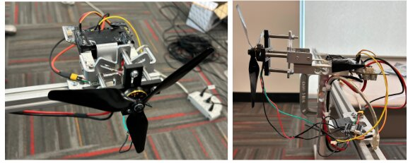

---
# ─────────────────────────────────────────────────────────────────────────────
# Carnegie Mellon University's partner file. Edit the fields below and the text
# under the second "---". See CONTRIBUTING.md for how to preview before publishing.
# ─────────────────────────────────────────────────────────────────────────────
short: CMU
institution: Carnegie Mellon University
lab: AirLab
lead: Prof Sebastian Scherer
role: Partner
contribution: AirStack flight software, safety filter and flight testing
summary: >-
  CMU's AirLab provides AirStack, the shared flight software that both strategy
  tracks run on, co-develops the safety filter, and flies the drone teams in its
  indoor flight cage.
# What you do on each layer (one line each, max 90 characters). Shown in the
# "who does what" grid on the home page. Layers: strategy, safety, flight, localisation, drones, integration.
work:
  safety: "Co-develops the safety filter with UPenn."
  flight: "Provides AirStack, the shared flight software for both tracks."
  localisation: "Provides the AirStack simulator and technical advice from its flight experience."
  drones: "Flies the drone team in its indoor flight cage in Pittsburgh."
logo: ./CMU/cmu.png
labLogo: ./CMU/airlab.png
logoAlt: Carnegie Mellon University
website: https://theairlab.org
order: 5
updated: 2026-11-03
people:
  - name: Prof Sebastian Scherer
    photo: ./CMU/people/sebastian-scherer.jpg
    lead: true
  - name: Yikuan Fang
    photo: ./CMU/people/yikuan-fang.jpg
  - name: Cao Muqing
    photo: ./CMU/people/cao-muqing.jpg
  - name: Henry Tung
    photo: ./CMU/people/henry-tung.jpg
  - name: Younkyung (Cindy) Woo
    photo: ./CMU/people/younkyung-woo.jpg
publications: []
---

## What we fly

We build **AirStack**, the flight software that turns a team plan into flight on
real Starling 2 Max drones. Both strategy tracks run on it, which is what makes a
fair comparison possible.

- **AirStack.** One autonomy stack for the whole programme, from simulation to
  real drones.
- **Safety filter.** Built with UPenn. It checks every command so the drones
  don't collide, whatever the strategy above it decides.
- **Flight testing.** Multi-drone flights in our indoor flight cage in Pittsburgh.

## October in the cage

In October 2026 three Starling 2 Max drones flew in our flight cage with no pilot.
They changed formation and kept their spacing. They flew to separate goals across
each other's paths. They kept going while a hand-flown drone cut across them, and a
virtual boundary kept every one of them inside the flight area.

That boundary didn't work first time. Before we fixed it, a drone flying at about
6 m/s overshot it by 0.35–0.68 m; now it stops within 0.02 m. More of our flight
recordings, with the settings behind them, are on our own project site.

In the same visit, the NUS team strategy went from palm-sized drones to full-size
Starlings on AirStack: the programme's first successful run on full-size drones.

## Before it flies

AirStack runs real and simulated drones side by side under the same safety filter, so we try new
ideas on simulated Starlings first.

From the July 2026 report: the safety filter works on velocity commands. We tested it first in a
point-mass simulation across drone sizes, safety distances, numbers of drones and speeds, then in the
AirStack simulator with a two-drone close-proximity test and a five-drone mission. AirStack can use
two simulators. AirSim starts in 6.75 s and Isaac Sim in 70.5 s, so we iterate in AirSim and keep
Isaac Sim for the high-fidelity checks before real flights. To make the simulated Starling match the
real one, we measured its motor thrust and motor response time (74 ms) on a test stand. The real
drone flies for 43 minutes on two 4 Ah batteries.

<figure class="clip"><video controls muted playsinline preload="none" poster="../../media/sim-cmu-safety-filter.jpg" aria-label="Simulation clip: the safety filter in a point-mass simulation"><source src="../../media/sim-cmu-safety-filter.mp4" type="video/mp4"></video><figcaption>Point-mass simulation: green arrows are the commands each drone (blue) was given; red arrows show where the filter changed one to keep the drones' safety rings apart.</figcaption></figure>

What comes next is a set of proposals, not yet demonstrated: solving the game mathematically for
each side, a fast controller learned from human pilots, games that mix real drones with simulated
opponents, and a safety filter that works from each drone's own map of its surroundings.

## Code and documentation

- Strike vs Guard ground control, project page and developer docs:
  <https://strike-vs-guard.github.io/svg-website/>
- AirStack: <https://github.com/castacks/AirStack>
