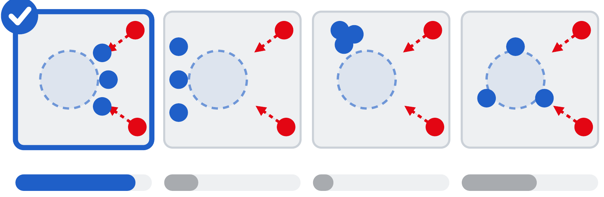
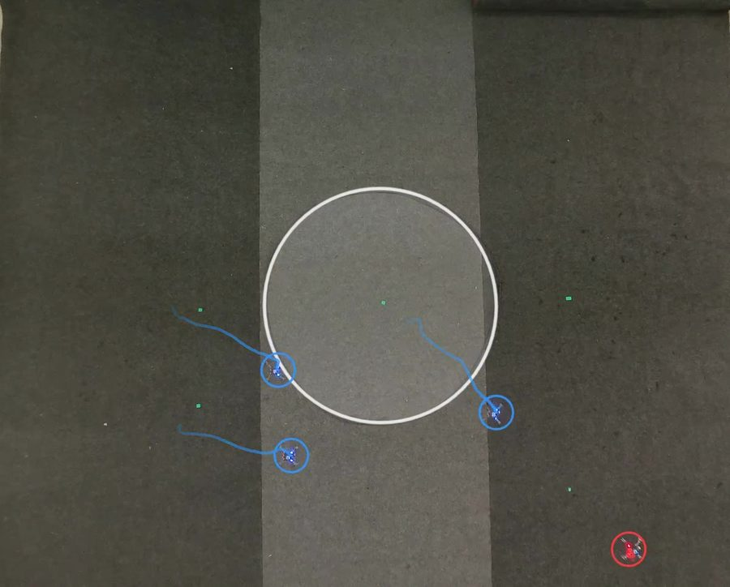

---
# ─────────────────────────────────────────────────────────────────────────────
# National University of Singapore's partner file. Edit the fields below and the
# text under the second "---". See CONTRIBUTING.md for how to preview before publishing.
# ─────────────────────────────────────────────────────────────────────────────
short: NUS
institution: National University of Singapore
lab: MARMot Lab
labFull: Multi-Agent Robotic Motion Lab
lead: Prof Guillaume Sartoretti
role: Partner
contribution: Learning-based strategy track
summary: >-
  The NUS MARMot Lab leads the learning-based approach: agents discover their
  own skills and team behaviours through experience, and a planner picks the
  play that best fits the situation.
# What you do on each layer (one line each, max 90 characters). Shown in the
# "who does what" grid on the home page. Layers: strategy, safety, flight, drones, integration.
work:
  strategy: "Leads the learning-based track: drones discover their own skills and team plays."
  drones: "First flew the team strategy on palm-sized Crazyflie drones."
logo: ./NUS/nus.png
labLogo: ./NUS/marmot-lab.png
logoAlt: National University of Singapore
website: https://www.marmotlab.org
order: 3
updated: 2026-11-02
---

## Our role in Strike vs Guard

The Multi-Agent Robotic Motion (MARMot) Lab at NUS leads the **learning-based
track** of the programme. Rather than hand-writing a playbook for each scenario,
the drones discover their own skills and team behaviours through experience.

## Approach

The team builds up a library of learned plays. For a given situation, a planner
predicts how well each play is likely to work and picks the best one, so the
team can adapt when the other side changes its approach.

**Strength:** finds moves nobody programmed.
**Trade-off:** its choices are harder to explain.

## Results so far

The NUS team strategy first flew on palm-sized Crazyflie drones, then on
full-size Starling 2 Max drones running CMU's AirStack.

## People

- Prof Guillaume Sartoretti, MARMot Lab, National University of Singapore
