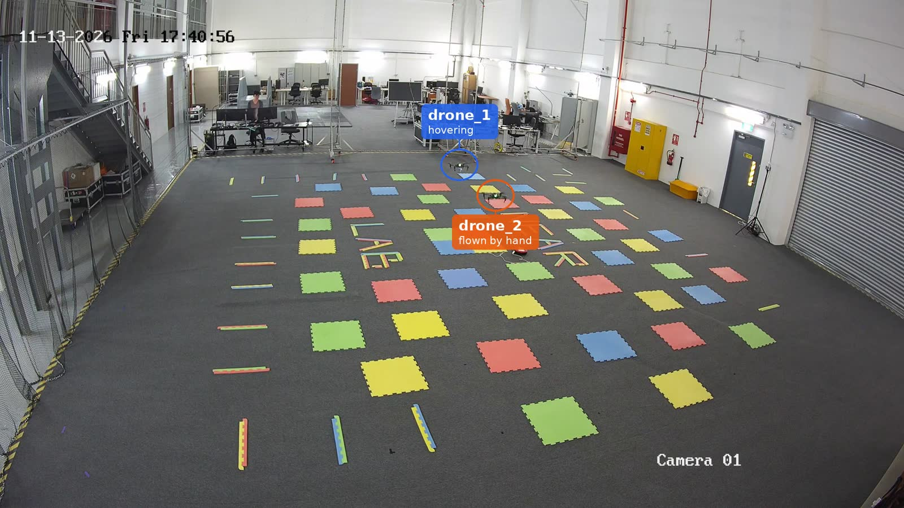
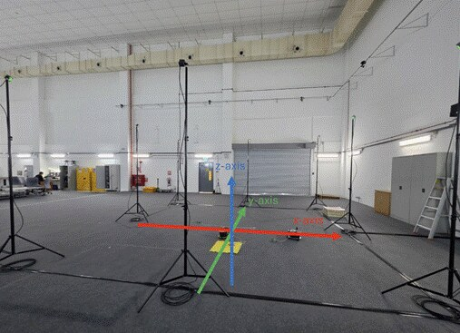
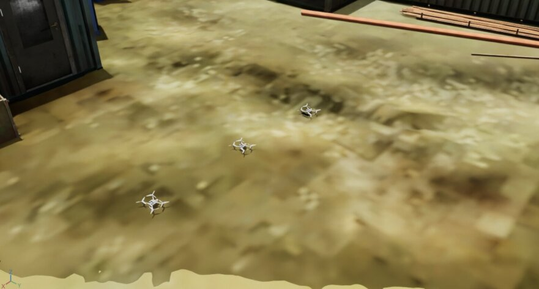

---
# ─────────────────────────────────────────────────────────────────────────────
# ST Engineering's partner file. Edit the fields below and the text under the
# second "---". See CONTRIBUTING.md for how to preview before publishing.
# ─────────────────────────────────────────────────────────────────────────────
short: ST Engineering
institution: ST Engineering
lab: AI.R.STC · NEAR Lab
labFull: AI and Robotics Strategic Technology Centre, NEAR Lab
role: Lead partner
contribution: Coordination, system integration and the Singapore flight lab
summary: >-
  ST Engineering's AI and Robotics Strategic Technology Centre coordinates the
  programme, integrates every layer of the system and runs the Singapore flight lab.
# What you do on each layer (one line each, max 90 characters). Shown in the
# "who does what" grid on the home page. Layers: strategy, safety, flight, localisation, drones, integration.
work:
  localisation: "Leads camera-based localisation: proven in simulation first, then on Starlings."
  drones: "Runs the Singapore flight lab."
  integration: "Coordinates the programme and brings every layer together on Starling 2 Max."
logo: ./ST/st-engineering.png
logoMark: ./ST/mark.png
labLogo: ./ST/near-lab.png
logoAlt: ST Engineering
website: https://www.stengg.com
order: 2
updated: 2026-11-03
people:
  - name: Jeremy Chia Hwe Huang
    role: Programme lead
    photo: ./ST/people/jeremy-chia.jpg
  - name: William Teo
    photo: ./ST/people/william-teo.jpg
  - name: Chen Jiaying
    role: Principal AI Engineer
    photo: ./ST/people/chen-jiaying.jpg
---

## What we build

We're the NEAR Lab in ST Engineering's AI and Robotics Strategic Technology Centre
(AI.R.STC), and we're the lead partner. In practice that means joining the
partners' work up into one system, from team strategy and safety down to flight
software and hardware, and running the Singapore flight lab where the drone teams
are tested.

- **Integration.** Getting the NUS and UPenn strategies, the safety filter and
  CMU's AirStack to run together as one stack on Starling 2 Max drones.
- **The Singapore flight lab.** An indoor flight space at ST Engineering, so we
  can test drone teams here as well as in CMU's cage.
- **Simulation and localisation.** Flying the Starling 2 Max in the AirStack
  simulator, and starting camera-only localisation there.
- **The game.** Running Strike vs Guard so the learning-based and formal
  approaches can be compared on the same hardware.

## The Singapore lab

The first Starling 2 Max flights have taken place in the Singapore lab, with more
drones on the way.

The lab is a netted flight volume in our hangar, tracked by OptiTrack cameras at up to 240 Hz, with
a wired network for tracking and a separate Wi-Fi network for commands. We commissioned it on
palm-sized Crazyflie 2.1 drones first, with a go/no-go preflight dashboard that we check before every
flight.

<figure class="clip"><video controls muted playsinline preload="none" poster="../../media/st-crazyflie-preflight.jpg" aria-label="Flight clip: a Crazyflie in the Singapore lab with the preflight dashboard"><source src="../../media/st-crazyflie-preflight.mp4" type="video/mp4"></video><figcaption>Commissioning on a Crazyflie: the preflight dashboard (left), the tracked position (top right) and the flight (bottom right).</figcaption></figure>

Bringing up the Starling takes six steps (status as of July 2026):

| Step | What it checks | Status |
|---|---|---|
| M1 | Rehearsal on three simulated drones, including a geofence breach and recovery | Done |
| M2 | Ground station: network, motion capture, clock sync | In progress |
| M3 | Drone link to the ground station, propellers off | Done |
| M4 | Tracking fused into the drone's estimate, propellers off | Ready to test |
| M5 | Hand-carry check through the flight volume | Ready to test |
| M6 | First flight: take-off, hover, landing | Ready to test |

## In the simulator

We brought the Starling 2 Max into the AirStack simulator (Isaac Sim with Pegasus) and built a
construction-site world for it, where up to three drones fly at once. Camera-only localisation runs
there first. Over a 162 m flight its position was off by 0.081 m on average, but that's measured
against the drone's own flight-controller estimate, not yet the simulator's true position. With three
Starlings flying, each kept track of itself without a loss.

We also rebuilt CMU's AirStack ourselves on the Starling 2 Max, to check that a second partner can
run it. Doing that turned up two bugs in the shared stack, which we fixed: a camera start-up race in
the simulator that made simulated drones fly erratically, and a fault that stopped the ground
controller after a single failed command.

<figure class="clip"><video controls muted playsinline preload="none" poster="../../media/sim-st-three-starlings.jpg" aria-label="Simulation clip: three Starlings in AirStack"><source src="../../media/sim-st-three-starlings.mp4" type="video/mp4"></video><figcaption>Three simulated Starlings: one drone's camera view (left) and all three in the ground station (right).</figcaption></figure>

