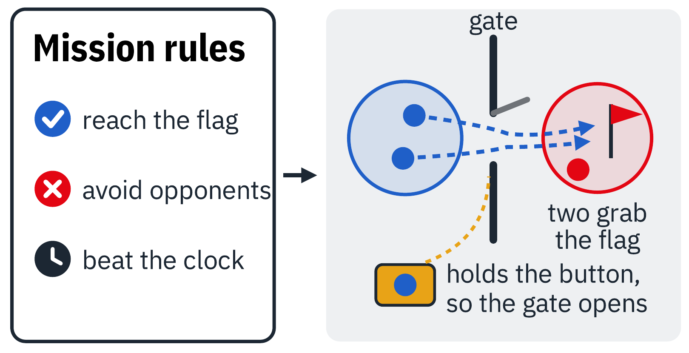

---
# ─────────────────────────────────────────────────────────────────────────────
# University of Pennsylvania's partner file. Edit the fields below and the text
# under the second "---". See CONTRIBUTING.md for how to preview before publishing.
# ─────────────────────────────────────────────────────────────────────────────
short: UPenn
institution: University of Pennsylvania
lab: xLab
lead: Prof Rahul Mangharam
role: Partner
contribution: Formal strategy track using signal temporal logic
summary: >-
  UPenn's xLab leads the formal approach: team behaviour is specified directly
  in signal temporal logic, so it can be checked against the rules it was
  written to follow.
# What you do on each layer (one line each, max 90 characters). Shown in the
# "who does what" grid on the home page. Layers: strategy, safety, flight, drones, integration.
work:
  strategy: "Leads the formal track: team behaviour specified in signal temporal logic."
  safety: "Co-develops the safety filter with CMU."
  drones: "Runs the formal-track strategy on the shared Starling 2 Max drones."
logo: ./UPenn/penn.png
labLogo: ./UPenn/xlab.png
logoAlt: University of Pennsylvania
website: https://xlab.upenn.edu
order: 4
updated: 2026-11-02
---

## Our role in Strike vs Guard

UPenn's xLab leads the **formal track** of the programme. Instead of letting the
team discover its behaviour, we specify it directly in **signal temporal logic
(STL)**: precise rules about what must happen, and by when.

## Approach

Engineers write the task as rules over time, such as *reach the flag*, *avoid
opponents* and *beat the clock*. The software then learns moves that satisfy
those rules and assigns roles within the team. In the example below, one drone
holds a button so that a gate opens, while two others go through and reach the
flag.

**Strength:** behaviour can be checked against the rules.
**Trade-off:** someone has to write the right rules.

With CMU, we also work on the safety filter that sits under both strategy
tracks and keeps the drones apart.

## People

- Prof Rahul Mangharam, xLab, University of Pennsylvania
